# 课刻 ClassTick · 皇家课程表 👑

> **v1.6 后台传令与原生壳版**：关闭应用也能收到 Web Push 传令、LLM 支持预设/本地模型/流式回复、Sunburst 表情帧与多套动作、单文件压到 1.7 MB，并附 Capacitor 原生壳。
>
> 今日朝程 / 本周王历 / 课程纹册 / 御前设置——羊皮纸、鎏金线、王室紫、九大纹章家族；电脑桌面小组件与手机 PWA 都能装。

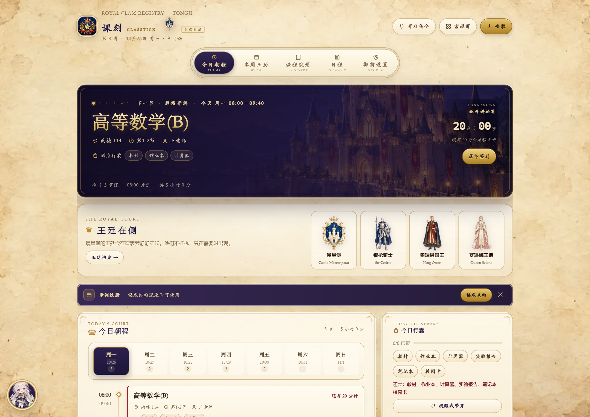

| 手机 · 今日朝程 | 导师 · 宫廷制服 | 导师 · 星夜礼服 |
| --- | --- | --- |
| 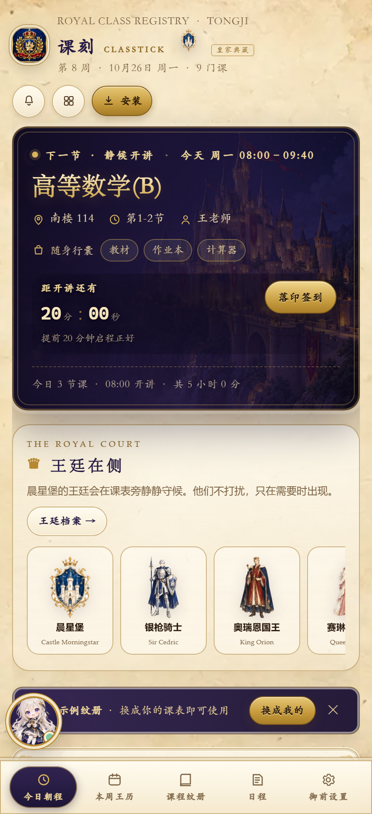 | 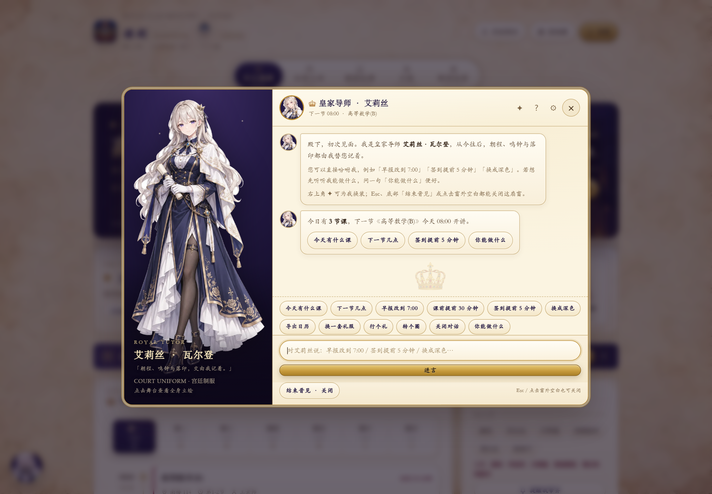 | 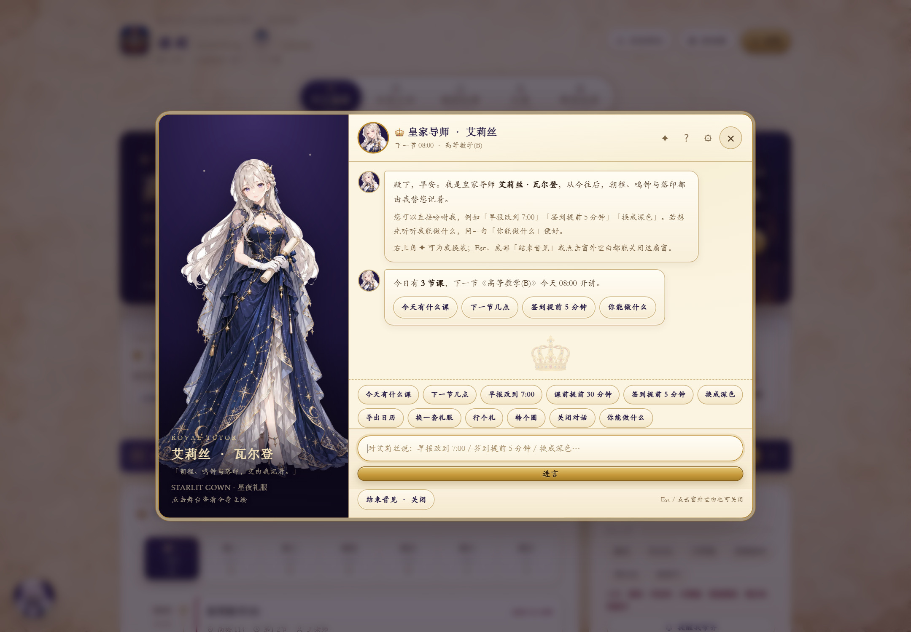 |

| 导师 · 白蔷薇礼服 | 手机 · 导师横幅 | AI 对话设置 |
| --- | --- | --- |
| 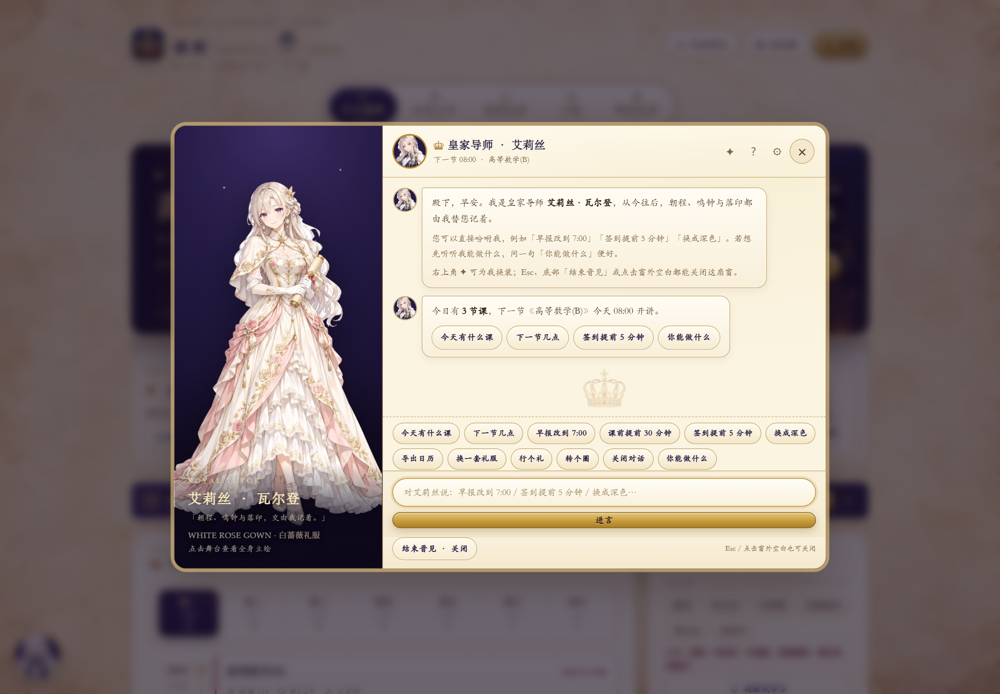 | 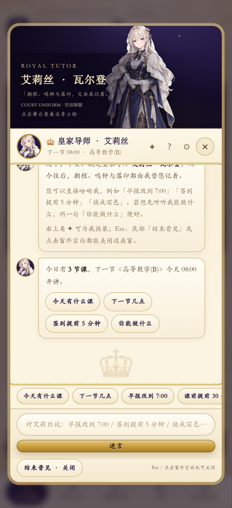 | 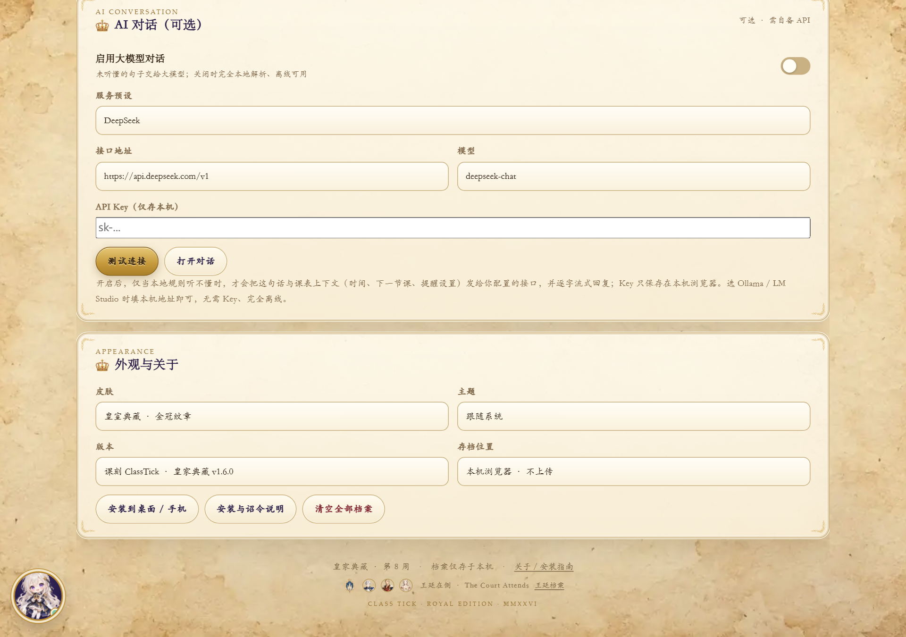 |

| 日程 · DDL | 日期切换 · 周二朝程 | 行囊勾选与未带提醒 |
| --- | --- | --- |
| 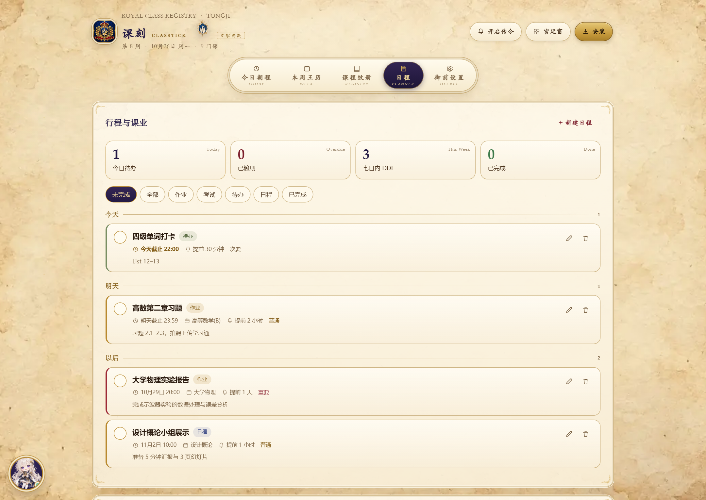 | 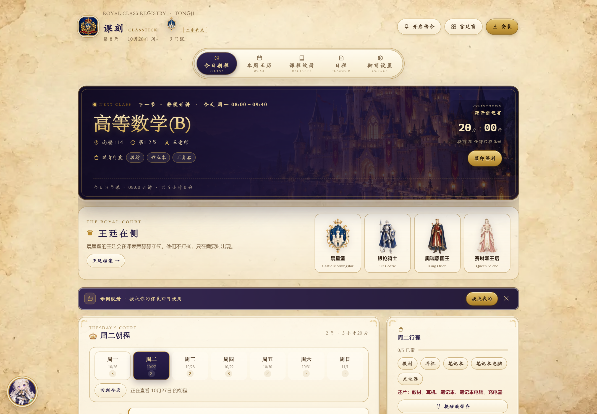 |  |

| 情境提示气泡 | 本周王历 | 夜堡主题 |
| --- | --- | --- |
| 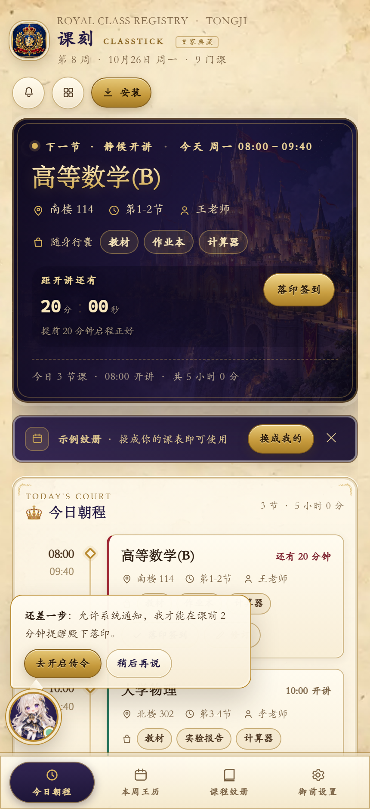 | 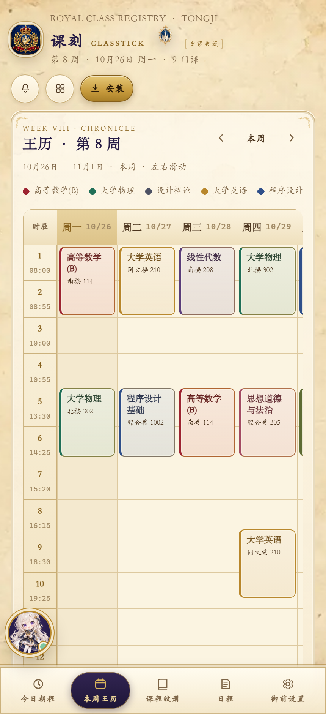 | 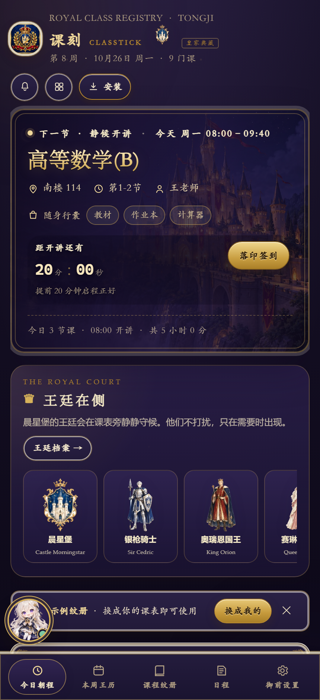 |

---

## 一分钟上手（Windows 电脑）

1. 双击 **`启动课刻.cmd`** → 后台启动零依赖本地服务并打开 <http://127.0.0.1:8788/>
   （需要 Node.js 20+；没装时脚本会提示）
2. 点浏览器地址栏右侧「**安装**」→ 课刻变成桌面应用
3. 双击 **`课刻-小组件.cmd`** → 420×820 应用窗口，拖到屏幕角落就是桌面小组件
4. 开机自启：**`课刻-开机自启.cmd`**；停止服务：**`课刻-停止服务.cmd`**
5. 点左下角 Q 版头像 → 唤来皇家导师，直接说「早报改到 7:00」「签到提前 5 分钟」

> 调试参数：`?skin=classic` 学院纸感、`?theme=dark` 夜堡、`?widget=1` 小组件、`?teacher=1` 召唤导师、`?outfit=star|rose` 预览礼服、`?now=2026-10-26T07:40` 冻结时间。

---

---

---

---

---

## v1.6：五项限制升级

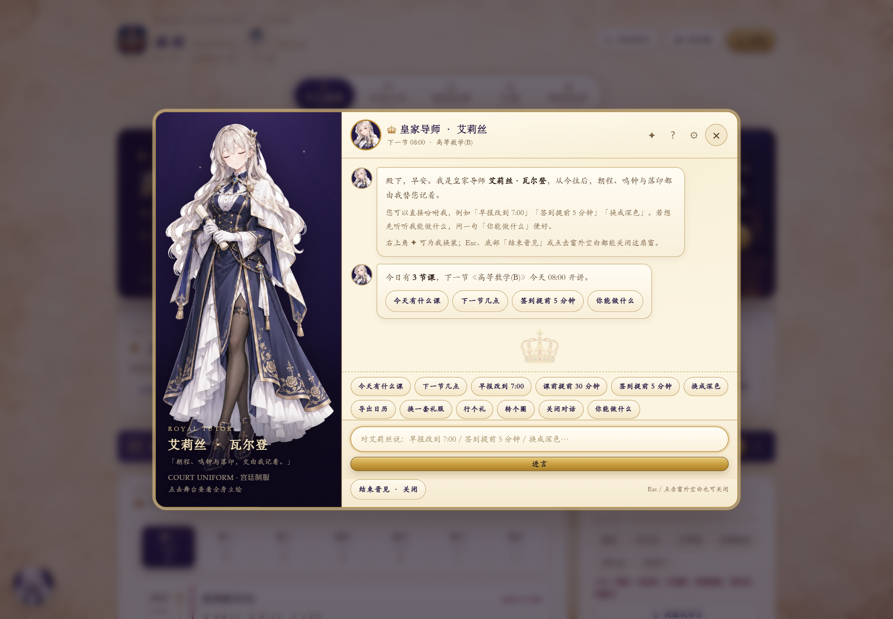


### 1. 关闭应用后的提醒：真 Web Push 服务端
- 新增 [`push-server.mjs`](push-server.mjs)：VAPID + 订阅 + 每 20 秒检查 + `web-push` 推送
- 前端设置页新增「后台传令 · Web Push」：开启后即使课刻完全关闭，服务端也会在课前 / 签到 / DDL 到点推送
- 复用同一套提醒引擎（早报、鸣钟、签到、暮色、任务 DDL、前晚预告）
- 需要 `npm install` 与保持 `node server.mjs` 运行；手机需 HTTPS 域名（iOS 16.4+ 且添加到主屏幕）
- 部署、API、安全注意事项见 [`docs/web-push.md`](docs/web-push.md)；`.ics` 仍保留为离线兜底

### 2. LLM：预设 + 本地模型 + 流式输出
- 服务预设：DeepSeek / 智谱 GLM / Kimi / 硅基流动 / **Ollama 本地** / **LM Studio 本地** / 自定义
- 本地模型（127.0.0.1）**无需 API Key**，完全离线；仍默认本地规则优先，只有听不懂且开启时才联网
- 支持 SSE 流式回复，文字逐字出现；LLM Key 只存本机，同步到推送服务时自动剔除
- 入口：「御前设置 → AI 对话（可选）」

### 3. Live2D-lite 2.0：Sunburst 表情帧 + 多套动作
- 用 **GPT-Image-2.5-Sunburst** 的 `/images/edits` 以原立绘为参考，生成 **眨眼 / 说话 / 微笑** 三张对齐表情帧
- 对话时自动张嘴、随机眨眼；新增「行个礼 / 转个圈 / 点点头 / 眨眨眼」动作（CSS 轻量骨骼之外的表演）
- 仍是轻量方案，不是 Cubism 骨骼模型；但已从「单张呼吸」升级为「有表情、有动作」
- 原始帧：[`assets/teacher/raw/full-blink.png`](assets/teacher/raw/full-blink.png)、`full-talk.png`、`full-smile.png`

### 4. 单文件版：4.2 MB → 1.7 MB
- 新增 `tools/optimize_single_assets.py`：为单文件专门生成压缩素材（不含 raw）
- 构建优先使用 `assets/opt/`，正常站点仍用全尺寸素材
- `dist/课刻-手机版.html` 现为 **1.7 MB**，离线素材仍全部内联

### 5. 原生壳：Capacitor Android 工程已就绪
- `capacitor.config.json` + `tools/prepare_native.mjs` + `android/` 工程
- 命令：`npm run native:prepare` → `npm run native:sync` → `npm run native:android`
- 本机没有 Java/Android SDK，**未构建 APK**；装 Android Studio 后可直接编译
- 原生通知与系统小组件说明见 [`docs/native.md`](docs/native.md)

### 新增依赖与命令

```bash
npm install                 # web-push / Capacitor（仅服务端与原生壳需要）
npm start                   # 静态 + Web Push 服务
npm test                    # 62 项核心单测
npm run qa                  # 截图 / 自测 / Push / 表情专项
npm run build               # 单文件（1.7 MB）
npm run native:prepare      # 生成 native/www
npm run native:sync         # 同步 Android 工程
npm run native:android      # 打开 Android Studio
```

> 不装 `npm install` 时静态服务仍可运行（`node server.mjs`），只是没有后台推送。

## v1.5：城堡、王廷与旅行魔女

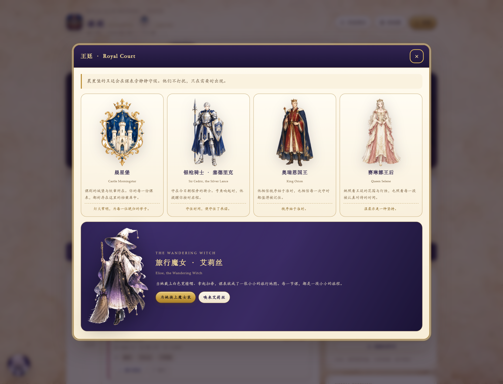


| 旅行魔女 · 艾莉丝 | 王廷 · 手机 |
| --- | --- |
| 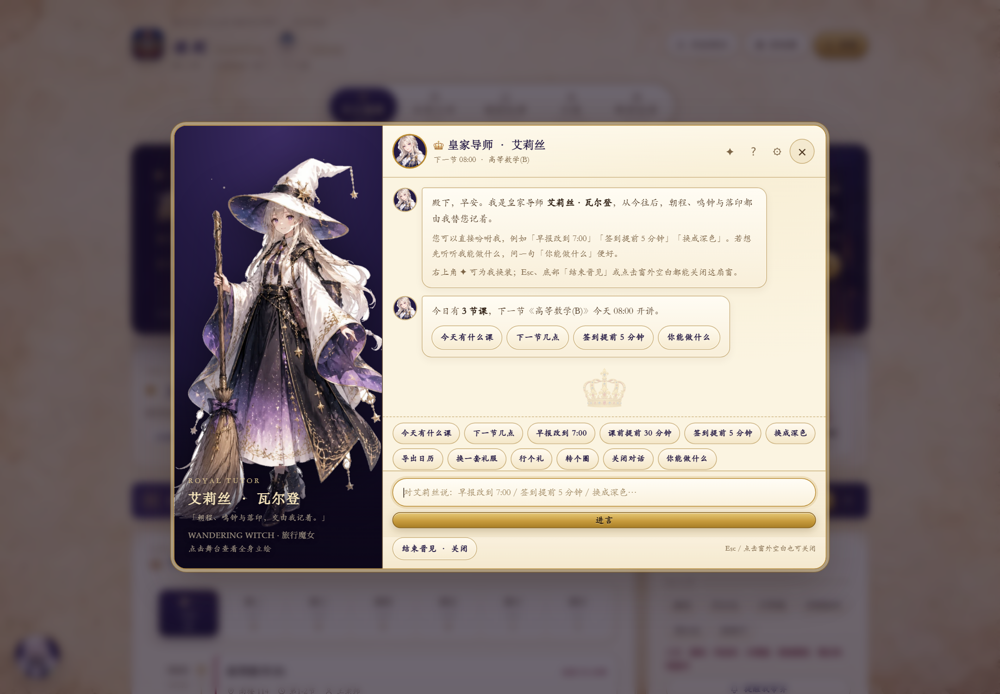 | 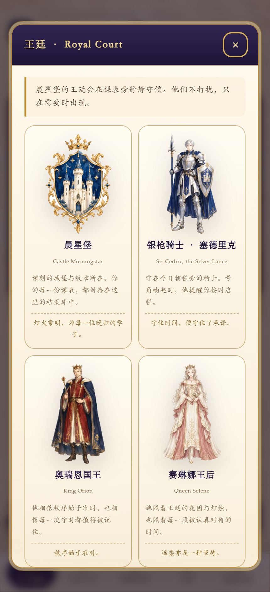 |

### 新增内容
- **城堡纹章图标**：晨星堡纹章（GPT-Image-2 出图，Pillow 去底/WebP），用于顶栏标题旁、王廷巡礼与页脚。
- **王廷角色**：银枪骑士 · 塞德里克、奥瑞恩国王、赛琳娜王后；今日页新增「王廷在侧」巡礼条，点击打开「王廷档案」弹层，含中文名/英文名/铭文/小传。
- **旅行魔女装**：艾莉丝第四套服装「旅行魔女 · Wandering Witch」——白色宽檐帽、星空内衬长袍、扫帚；✦ 换装循环、设置下拉、`?outfit=witch` 预览均可切换；王廷档案内可一键换装。
- **行囊勾选强化**：除了今日行囊清单，Hero 的「随身行囊」也变成可勾选按钮；勾选后划线+✓，侧栏进度 `x/y 已带`、未带提醒、课前传令自动带上「还差：…」。
- 魔女装舞台新的星光/微摆动效；王廷/徽记动效全部尊重 `prefers-reduced-motion`。

### 制作管线
| 环节 | 工具 / 产物 |
| --- | --- |
| 王廷立绘（城堡/骑士/国王/王后） | **GPT-Image-2**（Fucheers，`tools/court_assets_spec.json`）→ `assets/royal/raw/court/*.png` |
| 魔女装 | GPT-Image-2 → `assets/teacher/raw/witch.png` |
| 视觉/文案/落位方案 | **Opus 5.5** → [`docs/royal-court.md`](docs/royal-court.md)：参考《魔女之旅》的欧式奇幻、旅行感、魔女帽与扫帚意象，角色原创、不复制 IP |
| 后处理 | `python tools/process_court_assets.py`：白底去透明、裁边、WebP、页脚小像裁切 |
| 验收 | 37 项页面自测、62 项核心单测、王廷素材加载/档案/魔女装专项检查 |

### 调试参数新增
| 参数 | 作用 |
| --- | --- |
| `?court=1` | 启动即打开「王廷档案」 |
| `?outfit=witch` | 预览旅行魔女装 |

## v1.4：行囊勾选 · 日期切换 · 日程/DDL

### 修复（本次 Debug）
| 问题 | 根因 | 修复 |
| --- | --- | --- |
| 聊天页无法下拉、看不到全身 | 导师弹层 grid 行高没有约束，聊天记录把内容撑到 3000+ px，再被 `overflow:hidden` 裁掉 | `grid-template-rows: minmax(0,1fr)` + 聊天区 `min-height:0/overflow:hidden`；日志实测可滚动，立绘完整显示 |
| 有概率无法关闭、点空白也关不掉 | 弹层被撑到数千 px，看似「窗外」的点击其实仍在弹层内部 | 同上修复尺寸；另加打开守卫（已打开不再重复 showModal）；20 次连续开关 0 失败 |
| 看不到全身立绘 | 桌面舞台只能看裁剪版、手机横幅只到腰际 | 点击立绘舞台打开「全身立绘」弹层，三套礼服同步切换 |

### 新功能
**1. 今日行囊勾选 + 未带提醒**
- 「今日行囊」每件物品变成可点选按钮：点一下标记已带（划线 + ✓），进度 `3/5 已带`
- 实时列出「还差：计算器、作业本」，一键「提醒我带齐」（应用内 + 系统通知）
- 课前鸣钟 / 签到提醒的正文会自动追加「还差：…」
- 问艾莉丝「行囊还差什么」，她会报到具体物品

**2. 本周朝纲 / 日期切换**
- 「今日朝程」新增 7 天日期条：显示每天课数，点击切换到对应日期的朝程
- 侧栏「本周朝纲」小柱子、周视图日期头都可点击切换，选中日高亮
- 标题与英文 Eyebrow 同步（`TUESDAY'S COURT · 周二朝程`），行囊也切换成「周二行囊」
- 非今天时出现「回到今天」；支持 `?date=2026-10-27` 预览

**3. 日程 / DDL / 记作业**（交互参考 GitHub Issues / Projects：复选完成、类型标签、优先级、筛选与分组）
- 新导航「日程」：今日待办 / 已逾期 / 七日内 DDL / 已完成四张统计卡
- 筛选：未完成 / 全部 / 作业 / 考试 / 待办 / 日程 / 已完成；按「今天 / 明天 / 以后 / 已完成」分组
- 新建/编辑：标题、类型、关联课程、截止日期与时间、优先级、提前提醒、备注；支持勾选完成、删除
- 传令：默认截止前 60 分钟提醒，可自定义（截止时 / 15 分钟 / 1 小时 / 2 小时 / 1 天），另可开启「前一日暮色预告」（默认 20:30）
- 早报与晚间预告会自动带上当天/明天的 DDL；`.ics` 导出包含任务事件与 VALARM
- 艾莉丝能听懂「今天有什么作业」「记作业」「行囊还差什么」，并可打开日程表单
- 示例纹册内置 4 条演示作业/日程，第一次打开即可看到效果

## v1.3.1 修复记录（本次 Debug）

| 问题 | 原因 | 修复 |
| --- | --- | --- |
| 打开「安装」后无法滑动查看完整信息 | 安装说明弹层没有可伸缩的滚动容器，正文撑开后被对话框 `overflow:hidden` 裁掉，页脚与关闭不可见 | 非表单弹层改为 flex 列：头部/页脚固定、正文 `flex:1 + min-height:0 + overflow-y:auto`；移动端 390/360 实测可滚动到底，页脚与关闭常驻 |
| 再次打开导师找不到关闭窗口 | 关闭按钮只在右上角一个小图标里，窄屏标题换行挤压头部，可发现性差 | 头部 × 放大到 36px 圆形按钮；新增底部「结束晋见 · 关闭」常驻按钮；支持 Esc、点击窗外空白关闭；窄屏标题不换行 + 缩字号；模态打开时锁定背景滚动 |
| 换装等功能没有明显提示 | 提示 toast 被 `<dialog>` 的 top layer 遮住，弹层内看不到 | toast 自动路由进当前弹层：导师对话内显示为聊天区金色提示条（不遮挡底部按钮），其他弹层显示为内部浮条；换装同时更新立绘、服装名、对话回复，并让 ✦ 按钮闪一下 |
| 额外排查发现 | 所有弹层点击遮罩不能关闭；课程编辑等表单弹层同样有滚动风险 | 统一支持点击遮罩关闭；课程编辑弹层在增加多个时间段后实测正文可滚动、页脚与关闭可见；安装说明、导入、确认弹层均做回归 |

回归覆盖：桌面 1280 / 手机 390 / 窄屏 360，`Esc`、遮罩、底部按钮三种关闭方式，关闭后重开，换装提示层级，安装说明滚动到底。

## 本次三项优化

### 优化一：新纹章图腾 + 动态效果 + 点击反馈

**新桌面图标**由 GPT-Image-2 重新绘制：皇冠、盾徽（城堡 + 羽笔 + 卷轴）、月桂环、深红缎带与宝石，深蓝珐琅底 + 鎏金浮雕，作为 PWA / 桌面 / 手机主屏图标与顶栏纹章。


动态与点击效果（全部尊重 `prefers-reduced-motion`）：

| 效果 | 位置 |
| --- | --- |
| 极光缓移 + 漂浮金尘 | 全站背景（`royal-aura` / `royal-dust`） |
| 纹章流光扫过、悬停旋转、点击金星迸发 | 顶栏 Logo |
| 城堡卡流光扫过 + 金边呼吸 | 今日 Hero |
| 当前日列呼吸金线 | 本周课表 |
| 点击涟漪 | 所有按钮 / 标签 / 课程块 / 悬浮头像 |
| 悬停微抬 + 金线高亮 | 面板、课程块、按钮 |
| 导师呼吸、视差、星光、换装渐隐 | 导师立绘舞台 |

### 优化二：字体排版与皇室英文

- 英文小标字体为 Palatino / Book Antiqua 系，字距 `.24em`；中文标题保持华文宋体、正文微软雅黑
- 导航双语：`今日朝程 TODAY / 本周王历 WEEK / 课程纹册 REGISTRY / 御前设置 DECREE`
- 品牌行新增 `ROYAL CLASS REGISTRY · TONGJI`；页脚英文铭牌 `CLASS TICK · ROYAL EDITION · MMXXVI`
- Hero：`NEXT CLASS` + 中文 kicker、`COUNTDOWN` 小标；面板标题统一「英文 Eyebrow + 中文标题 + 皇冠徽记」
- 周次用罗马数字：`WEEK VIII · CHRONICLE`；课程卡片显示 `House of the Crimson Lion · The Bold Prevail` 等纹章家族英文
- 同步调整了字号阶梯、行高、面板留白与标题层级，桌面与手机各有一套比例

### 优化三：艾莉丝换装 + Live2D-lite + 可选大模型对话

**三套服装**（GPT-Image-2 同一角色设定生成，Pillow 抠图压缩）：

| 服装 | 说明 |
| --- | --- |
| 宫廷制服 Court Uniform | 默认深蓝金边制服 + 白色披风 |
| 星夜礼服 Starlit Gown | 午夜蓝星座刺绣礼服 + 薄纱披肩 |
| 白蔷薇礼服 White Rose Gown | 象牙白与玫瑰粉宫廷礼服 |

换装入口：对话右上角 **✦** 循环切换；或「御前设置 → 皇家导师 → 导师服饰」。桌面端立绘舞台即时渐隐切换，手机端顶部横幅同步换装。

**Live2D-lite**（轻量动态，不是 Cubism 骨骼模型）：
- 立绘呼吸缩放（7s 循环）+ 鼠标在舞台上的视差位移
- 舞台星光闪烁、底部金色光晕呼吸
- Q 版头像呼吸、悬停光环
- 换装淡入淡出；全部可由 `prefers-reduced-motion` 关闭

**可选大模型对话（默认关闭）**：
- 设置页新增「AI 对话（可选）」面板：开关、接口地址（默认 `https://api.deepseek.com/v1`）、模型（默认 `deepseek-chat`）、API Key、测试连接
- 默认仍走**本地规则引擎**（离线、零延迟）；只有本地听不懂的句子、且开关打开时，才把这句话 + 课表上下文（时间、下一节课、提醒设置）发给你配置的接口
- 请求失败会温柔兜底，不影响本地指令；Key 只保存在本机浏览器 localStorage
- 开启后对话标题出现 `AI` 徽标，输入框提示也会变化

---

## 皇家导师 · 艾莉丝（可交互课表管家）


- **能改设置**：早报时间、鸣钟提前量、签到分钟数、四类传令开关、深色/浅色、双皮肤、导出日历/JSON、申请通知、添加课程、落印签到
- **能查朝程**：今天有什么课、明天有课吗、下一节几点、本周几节课、第几周、教室与行囊
- **情境主动提示**：没开通知 / 示例课表 / 临近上课时主动出现，气泡按钮可直接执行
- **完整说明与指令表**：[`docs/royal-tutor.md`](docs/royal-tutor.md)

| 你可以说 | 她会做 |
| --- | --- |
| 早报改到 7:00 / 七点半 | 改晨钟早报 |
| 课前提前 30 分钟 / 签到提前 5 分钟 | 改鸣钟与签到 |
| 关闭晚间预告 / 开启晨钟早报 | 开关传令 |
| 换成深色 / 换回学院皮肤 | 换主题与皮肤 |
| 今天有什么课 / 下一节几点 | 报朝程 |
| 导出日历 / 备份课表 | 导出 ics / JSON |
| 签到 / 落印 | 为下一节课落印 |
| 换一套礼服 | 切换导师服装 |
| 你能做什么 / 重新认识你 | 能力指引 / 初见重播 |

---

## 美术管线

| 环节 | 使用的模型 / 工具 | 产物 |
| --- | --- | --- |
| 皇室素材 | **GPT-Image-2**（Fucheers 通道，`gptimage.py`） | 纹章图标 v2、城堡夜空、羊皮纸、金线角花、皇冠、红蜡封、金色分隔纹、玫瑰窗 |
| 导师立绘 | **GPT-Image-2** | 全身立绘、半身像、托腮思考、Q 版头像、星夜礼服、白蔷薇礼服 |
| 文案与视觉规范 | **Opus 5.5**（`opus-bridge`） | [`docs/royal-art-direction.md`](docs/royal-art-direction.md)：皇家文案包、调色板、九大纹章家族、字体分工、设计禁忌 |
| 素材后处理 | Python + Pillow | 白底抠透明、角花四向翻转、WebP 压缩、PWA 多尺寸图标、头像裁切 |
| 视觉验收 | puppeteer-core + 无头 Chrome | 20+ 张桌面/手机/导师/换装/深色截图 + 页面自测 + PWA + 交互检查 |

```bash
python tools/process_royal_assets.py     # 皇室素材与图标（优先 icon-v2）
python tools/process_teacher_assets.py   # 导师立绘 / 头像 / 三套礼服
```

---

## 功能

### 今日朝程
- 下一节课大卡片：课名、教室、节次、老师、时间 + 实时倒计时（城堡夜空主视觉、流光与金边呼吸）
- 随身行囊自动汇总；今日时间线（进行中高亮、已散课变淡、金色菱形节点）
- 落印签到：一键记录，可填学习通 / 雨课堂签到页链接

### 本周王历
- 周一至周日 × 12 节网格，纹章色课程块、单双周自动过滤
- 当前周 / 今日列高亮；点课程块直接编辑；上一周 / 本周 / 下一周

### 提醒（页面打开时由浏览器准点触发）
| 传令 | 默认 | 内容 |
| --- | --- | --- |
| 晨钟早报 | 07:20 | 今天所有课的时间、地点、行囊 |
| 鸣钟示警 | 课前 20 分钟 | 「号角响起 · 20 分钟后开讲」+ 教室 + 行囊 |
| **御前签到** | **课前 2 分钟** | 「请落印签到」+ 一键落印 + 签到入口 |
| 暮色预告 | 21:30 | 明天几节课、几点、在哪 |

### 课程 / 设置 / 数据
- 可视化课程编辑器：多时间段、周次（`1-16` / `1-16单` / `2-16双` / `1,3,5-9`）、教室、行囊、纹章颜色
- 学期第一周日期与总周数可改；作息时辰可改；夜堡深色主题
- 离线缓存 + PWA 安装 + 桌面小组件窗口 + 开机自启脚本
- 导出 / 导入 JSON；导出 `.ics`（每节课两个 VALARM 闹钟）交给系统日历

---

## 提醒的真实边界（重要，不忽悠）

 - ✅ **页面打开时**（含桌面应用、最小化、手机主屏幕打开）：到点弹系统通知
 - ✅ **后台传令（Web Push）**：服务端运行时，**完全关闭课刻**也会在课前 / 签到 / DDL 到点推送（需 `npm install` + 服务常开 + 手机 HTTPS）
 - ✅ **导出 .ics 给系统日历**：服务端/电脑关掉后的最终兜底，跨设备最可靠
 - ⚠️ **服务端必须保持运行**：电脑关机、进程停止、VPS 宕机时不会推送；纯静态托管无法提供 Push 服务
 - ❌ 纯 Web 进不了 Android AppWidget / iOS WidgetKit / Windows 小组件系统位；课刻用「应用窗口」实现等价的常驻小窗

 **建议**：电脑装成应用 + 开机自启；需要关掉也提醒就部署 [`docs/web-push.md`](docs/web-push.md)；再把 `.ics` 导入系统日历做双保险。

---

## 手机怎么装

| 方式 | 做法 | 结果 |
| --- | --- | --- |
| 最快 | 把 [`dist/课刻-手机版.html`](dist/课刻-手机版.html)（约 1.7 MB，内联全部素材）发到手机浏览器打开 | 离线可用，可「添加到主屏幕」 |
| 安卓 APK | 安装 [`dist/课刻-ClassTick-v1.6-Android.apk`](dist/课刻-ClassTick-v1.6-Android.apk)（约 14 MB，自签名） | 原生壳安装包，离线可用 |
| 局域网 | 电脑开服务，手机同 Wi-Fi 打开启动窗口里打印的地址 | 能看，不能正式安装 |
| 正式 PWA | 把 `class-tick` 文件夹拖进 [Netlify Drop](https://app.netlify.com/drop) 或 GitHub Pages | 手机正式安装、可收通知 |
| 可靠提醒 | 课刻导出 `.ics` → 导入系统日历 | 关掉课刻也提醒 |
| 关闭也响 | 按 [`docs/web-push.md`](docs/web-push.md) 部署 HTTPS 服务，在设置里开启后台传令 | 完全关闭应用也能收到推送 |

详见 [`docs/安装与部署.md`](docs/安装与部署.md)；示例日历 `dist/课刻课表_示例.ics`（275 个带闹钟事件）。

---

## 换成自己的课表

第一次打开是**同济大学风格的示例纹册**（9 门课，含单双周），点首页「换成我的」或进「课程纹册」：

1. 右上角 **+ 添加课程**（皇家皮肤下叫「册封新课程」）
2. 填课名、选纹章颜色
3. 「+ 增加时间段」：星期、起止节次、地点、周次、随身行囊
4. 保存回首页即可看到倒计时

也可以改 `assets/课表模板.json` 后导入，或在「御前设置 → 学期信息 / 作息时辰」调整。

---

## 技术栈与项目结构

**前端零依赖**：原生 HTML/CSS/JS + PWA（manifest + Service Worker 离线缓存），无 CDN、无统计脚本。Node 服务端在 v1.6 增加可选 `web-push` 依赖（后台传令）与 Capacitor 原生壳依赖；不安装时静态服务照常运行。

```
class-tick/
├─ index.html                  # 应用外壳 + 导师入口/对话 + 动态光效层
├─ assets/
│  ├─ style.css                # 基础设计系统 + 学院纸感
│  ├─ royal.css                # 皇室典藏皮肤
│  ├─ royal-polish.css         # 英文排版 / 动态光效 / 点击反馈 / Live2D-lite
│  ├─ teacher.css              # 皇家导师 UI（立绘舞台/对话/换装/表情/动作）
│  ├─ court.css                # 王廷/城堡/魔女/后台传令样式
│  ├─ planner.css              # 日程/行囊/日期样式
│  ├─ core.js                  # 纯逻辑 + 皮肤/导师/LLM 设置项
│  ├─ app.js                   # 渲染、双皮肤文案、导师意图引擎、LLM 可选接入
│  ├─ seed.js                  # 示例课表
│  ├─ 课表模板.json             # 导入模板
│  ├─ royal/                   # 皇室素材（webp）+ raw/ 原图
│  └─ teacher/                 # 导师立绘/头像/Q 版/礼服（webp）+ raw/ 原图
├─ sw.js / manifest.webmanifest
├─ icons/                      # 纹章图标（192/512/maskable/apple/badge/favicon/svg）
├─ server.mjs                  # 本地服务器（静态 + 可选 Web Push）
├─ push-server.mjs             # VAPID / 订阅 / 调度 / 推送
├─ capacitor.config.json       # Capacitor 原生壳配置
├─ android/                    # Capacitor 生成的 Android 工程
├─ native/www/                 # 原生壳 Web 资源（prepare_native 生成）
├─ 启动课刻.cmd / 课刻-小组件.cmd / 课刻-开机自启.cmd / 课刻-停止服务.cmd
├─ tools/
│  ├─ start.ps1                # 启动/小组件/自启/停止
│  ├─ royal_assets_spec.json   # 皇室素材出图清单
│  ├─ teacher_assets_spec.json # 导师立绘出图清单
│  ├─ polish_assets_spec.json  # 新图标与两套礼服出图清单
│  ├─ process_royal_assets.py  # 抠图/WebP/图标派生
│  ├─ process_teacher_assets.py# 导师素材/礼服处理
│  ├─ apply_royal_ui.py / apply_teacher_ui.py / apply_polish_ui.py / apply_polish_app.py
│  ├─ optimize_single_assets.py# 单文件压缩素材（1.7 MB）
│  ├─ prepare_native.mjs       # 生成 Capacitor www
│  ├─ build_single.mjs         # 单文件打包（内联全部素材）
│  └─ qa.mjs                   # 截图 + 自测 + PWA + Push + 表情检查
├─ tests/core.test.cjs         # 55 条核心逻辑单元测试
├─ shots/                      # 验收截图
├─ dist/                       # 单文件手机版 + 示例 .ics
└─ docs/
   ├─ 安装与部署.md
   ├─ royal-art-direction.md   # Opus 5.5 皇室文案与视觉规范
   ├─ royal-tutor.md           # 导师设定/指令表/换装/LLM/素材管线
   ├─ web-push.md              # Web Push 部署与安全
   ├─ native.md                 # Capacitor / 原生壳
   └─ research-widget-reference.md
```

### 开发者命令

```bash
node server.mjs                       # http://localhost:8788
node tests/core.test.cjs              # 单元测试（55 项）
node tools/qa.mjs                     # 截图 + 自测 + PWA + 导师/LLM/动效检查
node tools/build_single.mjs           # 打包单文件手机版 / 示例 .ics
python tools/process_royal_assets.py  # 重建皇室素材与图标
python tools/process_teacher_assets.py# 重建导师立绘/头像/礼服
```

### 调试参数

| 参数 | 作用 |
| --- | --- |
| `?now=2026-10-26T07:40` | 冻结时间预览（不触发提醒） |
| `?tab=today\|week\|courses\|settings` | 直接打开某个标签 |
| `?skin=royal\|classic` | 预览皇室 / 学院皮肤 |
| `?theme=dark\|light` | 预览夜堡 / 日间主题 |
| `?widget=1` | 小组件模式 |
| `?teacher=1` | 启动即打开皇家导师对话 |
| `?outfit=court\|star\|rose` | 预览导师服饰 |
| `?expression=blink\|talk\|smile` | 预览 Sunburst 表情帧 |
| `?selftest=1` | 页面内自测，结果写入 `<html data-selftest>` |

---

## 验收记录

- ✅ 核心逻辑单元测试 **62 / 62**
- ✅ 页面内自测 **40 / 40**（新增：日程、行囊、日期、王廷、魔女装、Hero 行囊、后台传令面板、AI 本地预设、Sunburst 表情帧）
- ✅ PWA 检查：SW 缓存 v1.6 全部素材、manifest 3 图标 + 导师快捷方式、纹章图标/角花/城堡主视觉加载
- ✅ 导师交互：对话、立绘、4 类设置意图、换装、双礼服加载、LLM 失败兜底全部实测
- ✅ 点击涟漪、英文标渲染实测；单文件版在 `file://` 下渲染正常且换装可用（data URI）
- ✅ Web Push：VAPID 公钥、服务状态、7 天提醒（42 条）实测；设置面板可开启
- ✅ 表情/动作：眨眼帧、行礼动作实测；单文件 1.7 MB 仍可换装/眨眼
- ✅ 控制台零错误；启动/停止脚本实测可用
- ✅ Android release APK 已构建并通过 apksigner 校验（14 MB，package `com.classtick.app`，versionName 1.6.0）

截图见 [`shots/`](shots/)，可用 `node tools/qa.mjs` 一键重跑。

---

## 设计与参考

- 皇室视觉规范（Opus 5.5）：[`docs/royal-art-direction.md`](docs/royal-art-direction.md)
- 皇家导师角色与指令表：[`docs/royal-tutor.md`](docs/royal-tutor.md)
- 同类产品：超级课程表、WakeUp 课程表、课程格子、系统日历
- 技术依据：[PWA 安装条件](https://web.dev/articles/install-criteria)、[后台定时器节流](https://developer.mozilla.org/en-US/docs/Web/API/Window/setTimeout)、[iOS Web Push](https://webkit.org/blog/13878/web-push-for-web-apps-on-ios-and-ipados/)、[VALARM 语法](https://icalendar.org/iCalendar-RFC-5545/3-8-6-3-trigger.html)
- 意象：权游纹章 / 王朝色板，迪士尼城堡夜色，ACGN 动画的优雅宫廷感（导师为原创角色）

---

## v1.6 后仍存在的边界

- [x] 关闭应用后的提醒：已实现 Web Push（服务端需保持运行；手机需 HTTPS；iOS 16.4+ 主屏 PWA）
- [x] LLM 需自备 API：已支持免费本地 Ollama / LM Studio，无需 Key；也提供国内常用预设
- [x] Live2D 轻量动效：已加 Sunburst 眨眼/说话/微笑帧与行礼/点头/转圈动作；**仍不是 Cubism 骨骼模型**，真 Cubism 需要绑定师与 `.moc3` 模型
- [x] 单文件 3.9 MB：已压到 **1.7 MB**（单文件专用素材）
- [x] 原生壳：已生成 Capacitor Android 工程；**APK 未构建**（本机无 Java/Android SDK），装 Android Studio 后按 [`docs/native.md`](docs/native.md) 编译
- [ ] 系统级桌面小组件（Android AppWidget / iOS WidgetKit）仍需原生插件，不是 Web 能直接做到的
- [ ] 公网 Web Push 需要自己部署 HTTPS 服务；纯静态托管无法承担

---

## 隐私

课表、签到记录只存在浏览器 `localStorage`；无账号、无上传、无统计脚本。导师本地意图解析不发网络；只有你主动开启 AI 对话并配置 Key 后，未识别的句子和课表上下文才会发送到你指定的接口（同步到后台传令时会剔除 LLM Key/Base）。开启后台传令后，课表与任务摘要会保存在你运行的服务端 `push-data/`，请勿公开该目录。换设备请用「导出 JSON / 导入课表」迁移。
