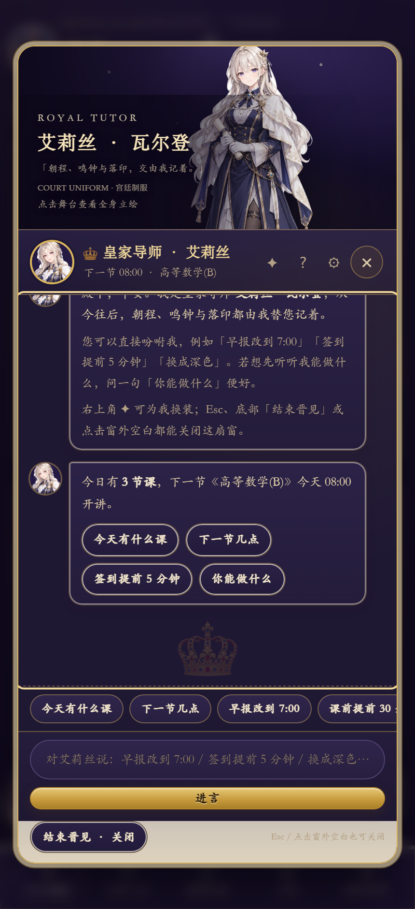

# 皇家导师 · 艾莉丝（可交互课表管家）

> 《课刻 ClassTick》在皇室典藏版里加入的 ACGN 角色向导。她不是装饰立绘：她认识你的课表，能听懂指令，并**直接替你修改设置**。

| 手机对话 | 夜堡主题 | 情境提示 |
| --- | --- | --- |
|  |  |  |

---

## 一、角色设定

| 项目 | 设定 |
| --- | --- |
| 姓名 | 艾莉丝 · 瓦尔登（Elise Waldron） |
| 身份 | 皇家导师（Royal Tutor），受命协助打理课业的宫廷教师 |
| 外貌 | 银金色长发（侧编辫）、紫罗兰色眼睛、深蓝与金色宫廷制服、白色短披风、金冠发饰、白手套，手持课表卷轴 |
| 性格 | 温和、得体、略带天然呆的正经人；称呼使用「殿下」，语气礼貌克制，不中二、不古风堆砌 |
| 职能 | 朝程（课表）、鸣钟（课前提醒）、落印（签到）三件事的管家 |
| 风格参考 | ACGN 动画质感，气质上参考《间谍过家家》的「优雅 × 谍战喜剧 × 温柔反差」——**原创角色**，不复制任何既有作品的角色形象 |

设计原则：皇家感只出现在语气、装饰和少量称谓里；时间、地点、课名、数字永远第一优先。

---

## 二、怎么互动

### 1. 入口
- **左下角 Q 版头像**：点击唤来艾莉丝；头像上绿点表示她在待命
- **情境气泡**：进入应用约 2.6 秒后，她会根据当前状态主动说一句话：
  - 没开通知 → 「还差一步：允许系统通知，我才能在课前 2 分钟提醒殿下落印。」
  - 示例课表 → 「示例纹册已备好。要现在换成殿下自己的课表吗？」
  - 有课 → 报出下一节、教室与行囊
  - 气泡里可以直接点按钮执行
- **设置页**：「皇家导师」面板可以显示/隐藏她，或「重新认识艾莉丝」
- **PWA 快捷方式**：`./?teacher=1` 启动即打开对话（manifest 里已注册「呼叫皇家导师」）

### 2. 对话能力（本地规则解析，不联网）

| 你可以说 | 她会做什么 |
| --- | --- |
| 早报改到 7:00 / 晚上八点 / 七点半 | 修改晨钟早报时间 |
| 课前提醒提前 30 分钟 | 修改鸣钟示警的提前量 |
| 签到提前 5 分钟 | 修改御前签到的提醒分钟数 |
| 关闭晚间预告 / 开启晨钟早报 | 开关四类传令 |
| 换成深色 / 浅色 / 跟随系统 | 切换主题 |
| 换成学院皮肤 / 换回皇室 | 切换皮肤 |
| 今天有什么课 / 明天有课吗 | 列出朝程、教室、行囊 |
| 下一节几点 / 还有多久 | 报出下一节课与倒计时 |
| 本周几节课 / 第几周 | 本周统计与学期周次 |
| 签到 / 落印 | 为当前或下一节课落印 |
| 导出日历 / 备份课表 | 导出 `.ics` / JSON |
| 开启通知 / 测试通知 | 申请通知权限 / 发测试传令 |
| 添加课程 / 册封课程 | 打开课程编辑器 |
| 重新认识你 / 你能做什么 | 自我介绍 / 能力说明 |
| 隐藏导师 | 让她退下（可在设置中唤回） |

**没有听懂时**：她会给出可点击的示例指令，而不是装作听懂了。

### 3. 对话内的快捷指令
对话底部提供一排快捷芯片（今天有什么课、下一节几点、早报改到 7:00、课前提前 30 分钟、签到提前 5 分钟、换成深色、导出日历、你能做什么），手机端可横向滑动。

---

## 三、视觉与动效

- **立绘**：全身立绘用于对话左侧舞台（桌面）/ 移动端隐藏舞台改用头像
- **头像**：脸部裁切圆形头像用于对话、气泡与消息
- **Q 版**：悬浮按钮与通知图标（通知栏显示 Q 版艾莉丝）
- **表情切换**：思考时头像切换为「托腮」版本
- **字体**：对话使用华文楷体，标题华文宋体，数字保持可读的无衬线
- **动效**：悬浮头像轻微起伏、光环呼吸、气泡弹出、打字三点；全部遵守 `prefers-reduced-motion`

---

## 四、素材是怎么来的

| 步骤 | 工具 / 模型 | 说明 |
| --- | --- | --- |
| 立绘、半身、思考、Q 版 | **GPT-Image-2**（Fucheers 通道 `gptimage.py`） | 纯白底、同角色描述、1024 级尺寸；提示词见 `tools/teacher_assets_spec.json` |
| 抠图 / 压缩 | Python + Pillow（`tools/process_teacher_assets.py`） | 四边 floodfill 去白底、保留服饰内部白色、WebP 压缩、脸部头像裁切 |
| 文案与语气 | **Opus 5.5**（`opus-bridge`） + 人工润色 | 沿用皇室文案规范，补充角色台词 |
| 验收 | puppeteer-core + 无头 Chrome | 立绘加载、对话开关、意图改设置、深色/浅色截图 |

> 运行时没有任何模型调用：所有意图解析都是本地正则 + 数字解析（含中文数字），因此**离线可用、零 API Key、零延迟**。若之后想升级成真正的自然语言对话，只需在 `teacherIntent` 前挂一个可选 LLM 接口即可。

### 提示词要点（立绘一致性）
- 同一句角色描述贯穿四张图：银金长发侧编辫、紫罗兰眼、深蓝金边宫廷制服、白色短披风、金冠发饰、白手套
- 纯白底 + 全身/半身/思考/Q 版四种取景
- 反面约束：无文字、无水印、无其他角色

---

## 五、代码位置

| 文件 | 内容 |
| --- | --- |
| `assets/app.js` | `TEACHER` 常量、`teacherIntent` 意图引擎、`teacherSay` 对话渲染、情境气泡、设置面板 |
| `assets/teacher.css` | 悬浮头像、气泡、对话面板、消息气泡、深色适配、响应式 |
| `assets/teacher/*.webp` | 处理后的导师素材（full / bust / avatar / thinking / chibi） |
| `assets/teacher/raw/` | GPT-Image-2 原始图 |
| `tools/process_teacher_assets.py` | 素材后处理 |
| `tools/teacher_assets_spec.json` | 出图提示词 |
| `tools/apply_teacher_ui.py` | 一次性接入补丁（保留以便复现） |
| `index.html` | 悬浮入口、对话 `<dialog>` 结构 |
| `core.js` | `settings.teacher` 开关 |

### 测试钩子
页面暴露 `window.__classtickTeacher = { open, close, ask, try, state }`，`try('签到提前 5 分钟')` 会执行意图并返回回复对象，QA 用它验证「导师能改设置」。

---

## 六、后续可以怎么加强

- [ ] 接入 LLM，让艾莉丝支持真正自由对话（带 API Key 时可开关）
- [ ] 多套服装 / 节日换装（万圣节、圣诞、期末应援）
- [ ] Live2D / 眨眼与口型动画
- [ ] 语音播报（Web Speech API，本地 TTS）
- [ ] 更多情境反应：连堂、下雨、考试周、连续迟到提醒

---

---

## 八、v1.3：换装、Live2D-lite 与可选大模型

### 多套服装

| 服装 | 文件 | 说明 |
| --- | --- | --- |
| 宫廷制服 Court Uniform | `assets/teacher/full.webp` | 默认；深蓝金边制服 + 白色短披风 |
| 星夜礼服 Starlit Gown | `assets/teacher/full-star.webp` | 午夜蓝星座刺绣礼服 + 薄纱披肩 |
| 白蔷薇礼服 White Rose Gown | `assets/teacher/full-rose.webp` | 象牙白 / 玫瑰粉宫廷礼服 |
| 旅行魔女 Wandering Witch | `assets/teacher/full-witch.webp` | 白色宽檐帽、星空内衬长袍、扫帚；参考《魔女之旅》的旅行气质，原创设计 |

- 入口：对话右上角 **✦** 循环切换；「御前设置 → 皇家导师 → 导师服饰」下拉选择；`?outfit=star|rose` 预览
- 切换时立绘 220ms 淡出淡入；手机端顶部横幅同步换装
- 设置项：`settings.teacherOutfit`（court / star / rose / witch）

### Live2D-lite（轻量动态）

真正的 Cubism Live2D 需要绑定骨骼模型，当前用 CSS/JS 实现「近似活物感」：

- 立绘 7 秒循环呼吸缩放（`transform-origin: 50% 100%`）
- 鼠标在舞台移动时立绘 ±7px 视差（CSS 自定义属性 + `translate`）
- 舞台四角星光闪烁、底部金色光晕呼吸
- Q 版悬浮头像呼吸、光环脉冲
- 换装淡入淡出；`prefers-reduced-motion` 下全部关闭

### 可选大模型对话（默认关闭）

设置页「AI 对话（可选）」面板：

| 字段 | 默认 | 说明 |
| --- | --- | --- |
| 启用大模型对话 | 关 | 关闭时完全本地解析、离线可用 |
| 接口地址 | `https://api.deepseek.com/v1` | OpenAI 兼容的 `/chat/completions` |
| 模型 | `deepseek-chat` | 可换成任意兼容模型 |
| API Key | 空 | 仅保存在本机 localStorage |

工作方式：

1. 所有输入先走本地规则引擎（`teacherIntent`），能识别的指令永远本地执行，不联网
2. 只有**本地听不懂**且开关打开时，才调用 `askLLM(text)`：把这句话 + 系统提示（角色、时间、第几周、今日课程、下一节、提醒设置）发到你配置的接口
3. 20 秒超时、失败自动兜底，不影响本地功能
4. 开启后对话标题出现 `AI` 徽标，输入框提示变化；「测试连接」会发一句问安验证
5. QA 钩子：`window.__classtickTeacher.llm = { ready, ask, test, configure }`

### 日程 / 行囊新指令（v1.4）

| 你可以说 | 她会做 |
| --- | --- |
| 今天有什么作业 / DDL 有哪些 | 列出未完成事项、今明两天截止的优先展示 |
| 记作业 / 新建日程 | 收起对话并打开日程表单 |
| 行囊还差什么 / 我带了什么 | 报告今日行囊未带物品 |
| 提醒我带齐 | 触发行囊提醒（应用内 + 系统通知） |
| 看日程 / 打开日程页 | 切换到「日程」标签 |

日程提醒默认并入传令：截止前 60 分钟 + 前一日 20:30 暮色预告；可在「日程 → 任务传令」调整。导出 .ics 时任务也会写入系统日历。

### 关闭与反馈（v1.3.1）

**四种关闭方式**：
1. 头部右上角圆形 **×**（已放大到 36px）
2. 底部 **「结束晋见 · 关闭」** 常驻按钮
3. 键盘 **Esc**
4. 点击对话框外的遮罩空白

**换装反馈**：
- 立绘 220ms 淡入淡出切换
- 舞台左下服装名更新（中文 + 英文）
- ✦ 按钮闪一下（金色光环）
- 聊天区插入金色提示条「已为艾莉丝换上 星夜礼服 · Starlit Gown」
- 艾莉丝在对话里回一句

弹层内所有 toast 都会路由到弹层内部，不再被 `<dialog>` 顶层遮挡；导师对话里以聊天区提示条呈现，避免挡住底部关闭按钮。

### 素材补充

- 新图标：`assets/royal/raw/icon-v2.png`（GPT-Image-2 纹章图腾）→ `icons/*`
- 两套礼服：`assets/teacher/raw/full-star.png`、`full-rose.png`
- 处理命令：`python tools/process_royal_assets.py`、`python tools/process_teacher_assets.py`
- 出图清单：`tools/polish_assets_spec.json`

---

## 七、关于 IP

本角色与《间谍过家家》及任何既有作品**没有关联**，仅在视觉气质上参考 ACGN 动画的通用风格。所有立绘均由图像模型按本项目原创设定生成。

---

## 九、v1.6 表情帧与动作

- 用 **GPT-Image-2.5-Sunburst** 的 `/images/edits` 在原立绘上生成对齐的眨眼、说话、微笑三帧（`full-blink.webp` / `full-talk.webp` / `full-smile.webp`）
- 对话时自动张嘴，随机眨眼；仅宫廷制服（court）启用表情帧，其他服装保持安静
- 新增动作：行个礼 / 转个圈 / 点点头 / 眨眨眼；对话快捷指令或直接说“行个礼”即可
- 原始帧与处理脚本：`assets/teacher/raw/full-*.png`、`tools/gen_expressions.py`、`tools/process_expressions.py`
- 仍为轻量 CSS/图片方案，非 Cubism 骨骼
